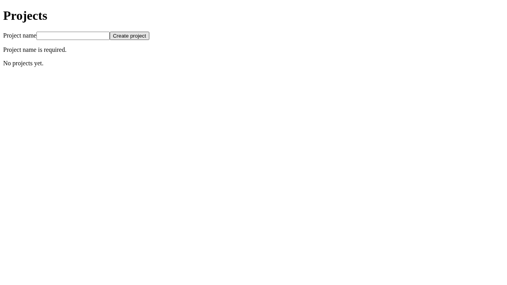
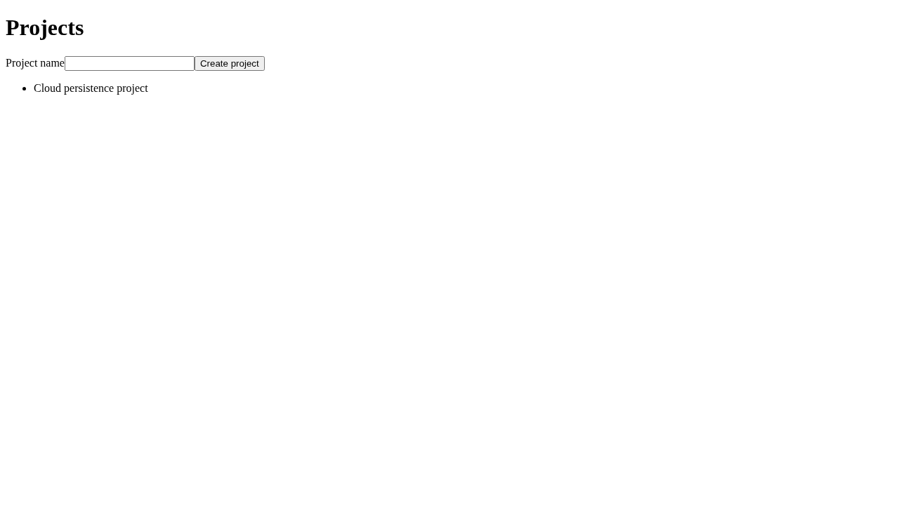

# Milestone 0, Phase B acceptance report

Status: **Passed automated qualification for the snapshot below; independent human
acceptance remains Not run. Local standalone scanner execution is incomplete.**
Implementation type: AI
Implementation author: Codex Cloud

PR: [#7, AI-authored draft](https://github.com/Johnson-Dev-Agent-Management/project-manager/pull/7).
Starting main: `688c1bd6c5fdbc5470b0c24abb41e3380a882a86`, containing merged Phase A PR #6.
Verified implementation head: `4a14cdc2e477c4941ad412db738007ade89b20fa`.
Tested PR merge: `6d3c7ae7952c53f4e1bd38ca33f89b618f149d3d`.
[Successful hosted run 40166873994](https://github.com/Johnson-Dev-Agent-Management/project-manager/actions/runs/40166873994).
Independent reviewer: owner/designated human; review and phase acceptance Not run.
One implementation agent; no independent AI review or orchestration.

The following snapshot is verified evidence, not a prediction for later commits.
This evidence follow-up adds screenshots/reporting and normalizes report/manifest
paths for Windows, plus fixes the npm formatting entry point's root ignore path. Backend floor
checks use covered/valid counts so rounded Cobertura rates cannot promote a
below-floor result; regressions cover reports whose rounded rates equal a floor.
The PR records the follow-up's actual tested head/merge SHA and final run after
inspection, without pretending this earlier run tested those later changes.

| Requirement | Outcome                                                | Evidence                                                                                                                                                                                                                                                                                                                                                                                                                                             |
| ----------- | ------------------------------------------------------ | ---------------------------------------------------------------------------------------------------------------------------------------------------------------------------------------------------------------------------------------------------------------------------------------------------------------------------------------------------------------------------------------------------------------------------------------------------- |
| B1          | Passed                                                 | Frontend lint, full TS/config typecheck, build, 13 behavioral tests in TS/TSX; 10 real SQLite cases; 23 Python tests. [Frontend](https://github.com/Johnson-Dev-Agent-Management/project-manager/actions/runs/40166873994/job/121089634272), [backend](https://github.com/Johnson-Dev-Agent-Management/project-manager/actions/runs/40166873994/job/121089634179). Behavior mapping and discovery/integrity rules in [standards](../engineering.md). |
| B2          | Passed                                                 | Baseline measured before changes; behavioral tests added before 80% line / 70% branch floors per codebase. Both coverage jobs pass, untested production files remain included. No revised target requested.                                                                                                                                                                                                                                          |
| B3          | Passed                                                 | Ten consecutive full production-output executions locally and in [hosted E2E](https://github.com/Johnson-Dev-Agent-Management/project-manager/actions/runs/40166873994/job/121089789357), 20 phase executions per qualification, one Chromium worker, zero retries. Same-run/commit artifact hashes verified.                                                                                                                                        |
| B4          | Passed in CI; local tools partly Not run               | [Policy](https://github.com/Johnson-Dev-Agent-Management/project-manager/actions/runs/40166873994/job/121089634178) and [supply-chain](https://github.com/Johnson-Dev-Agent-Management/project-manager/actions/runs/40166873994/job/121089634102) pass with diagnostics, fresh advisory data, no reported vulnerabilities/leaks. Local binary downloads blocked; details below.                                                                      |
| B5          | Passed (no operative exceptions)                       | No suppressed analyzer/lint/security rules, advisory allowlists, new coverage exclusions, or lowered targets. [Exception register and required approval fields](../engineering.md#security-exceptions-and-definition-of-done). Human policy review remains pending.                                                                                                                                                                                  |
| B6          | Passed (evidence supplied); independent review Not run | Exact commands, counts, tested SHAs, immutable run/job links, before/after coverage, screenshots, failures, limitations, and reproduction instructions below. AI-authored label and its exact description verified through GitHub API.                                                                                                                                                                                                               |

## Verified validation

All seven hosted jobs passed: frontend, backend, windows-smoke, e2e, policy,
supply-chain, quality-gate. The [gate](https://github.com/Johnson-Dev-Agent-Management/project-manager/actions/runs/40166873994/job/121090121085)
records both head and tested merge SHAs and explicit success for all six dependencies.
All six diagnostic artifacts plus both production artifacts were uploaded with
seven-day retention. The archive pins were verified before executing policy tools.

The run took **174 seconds** from workflow start to completion, approximately
**8.97 summed runner minutes** (538 job seconds). Job execution span was 171 seconds.
This is execution duration, not billed/rounded minutes or Windows multipliers.
The hosted ten-run browser sequence itself took approximately 49 seconds;
setup/browser installation/artifact transfer account for the rest of that job.
No new paid service or matrix was introduced. Warm feedback stayed under ten minutes.

**Passed locally on the implementation snapshot:**

```bash
bash scripts/setup.sh
bash scripts/check.sh
bash scripts/production-build.sh
bash scripts/e2e-qualify.sh
python3 -B scripts/python-tests.py
npm --prefix src/web run lint
npm --prefix src/web run typecheck
# Formatting commands used by policy.sh, run separately when archive download is blocked:
node src/web/node_modules/prettier/bin/prettier.cjs --check .
dotnet format src/api/ProjectManager.Api --verify-no-changes --no-restore --severity info
dotnet format tests/ProjectManager.Api.Tests --verify-no-changes --no-restore --severity info
npm --prefix src/web audit --json --audit-level=high
dotnet restore tests/ProjectManager.Api.Tests --locked-mode --force --no-http-cache
dotnet list tests/ProjectManager.Api.Tests package --vulnerable --include-transitive --format json --no-restore
python3 scripts/security-report.py
```

`security-report.py` reads JSON saved by `security.sh` under `.artifacts/security`;
when running its underlying commands manually, redirect npm/NuGet JSON to
`npm-audit.json` / `nuget-audit.json` there first. `check.sh` executes Vitest with
V8 coverage/JUnit and `dotnet test --no-build --no-restore --collect:"XPlat Code Coverage"`
with `tests/coverage.runsettings`, TRX, and isolated SQLite. Counts: 13 frontend,
10 backend, 23 Python (8 attribution + 15 CI/policy regressions), zero failed/skipped.
Backend build has zero warnings/errors. Local system Chromium **151.0.7922.173**
is explicitly reported as a fallback; hosted Chromium is matched Playwright
**1.64.0**, Chrome/Headless Shell **156.0.8078.4**, revision **1248**.
Node **24.22.0**, npm **11.9.0**, SDK **10.0.402**, local Python **3.12.14**.

Local qualification output `.artifacts/qualification/run-*/result.txt` records
head `4a14cdc2e477c4941ad412db738007ade89b20fa`. All ten per-run scenario paths
were distinct and absent after completion; all ten cleanup markers reported exit 0.
Hosted logs show iterations 1–10 and the final success line for merge
`6d3c7ae7952c53f4e1bd38ca33f89b618f149d3d`. Every execution uses a new SQLite
file, both phases, an actual API restart, production assets and Release API,
verified preview API proxy, and retained logs/results/screenshots before cleanup.

**Windows Passed:** [windows-smoke](https://github.com/Johnson-Dev-Agent-Management/project-manager/actions/runs/40166873994/job/121089634189)
uses native windows-2025 Git Bash, locked setup twice, strict frontend build
(including E2E/configs), and API/test-project builds with zero warnings/errors.
No test framework was replaced; the metadata-only privileged attribution workflow
is unchanged. Development API/proxy/SIGTERM cleanup and released development/E2E
ports also passed locally after the cleanup change.

**Failed during implementation (resolved or bounded):**

- Initial npm audit correctly failed for transitive undici **8.11.2**:
  **GHSA-xjj6-f33q-929c** (high), **GHSA-4qv8-2p9j-2685** and
  **GHSA-f72v-6w45-q472** (moderate). Compatible locked update to **8.12.3**
  cleared all findings. No suppression or forced dependency resolution was used.
- [Initial CI run 40166623302](https://github.com/Johnson-Dev-Agent-Management/project-manager/actions/runs/40166623302)
  on head `9c90feb176eaabca940d9428de0fda0e6a82cc23`, merge
  `15646256f9f6b55010aed5e6dd915774c5a980fb`, correctly failed policy and aggregate
  gate on ShellCheck **SC2329**, and E2E on run 2's port check. Diagnostics uploaded.
  Development cleanup is now invoked explicitly on the normal path and through
  its EXIT trap; no rule is suppressed. TCP TIME_WAIT was mistaken for a live
  listener after successful cleanup; reusable bind plus listen now distinguishes
  them. Two real-socket regressions cover reuse and safe occupied-listener rejection.
- A local qualification was invalidated when its running shell script was edited;
  it was discarded and the complete sequence restarted after committing/fixing
  the tree. No partial attempt is counted toward the ten consecutive pass.
- Local `bash scripts/policy.sh` fails at pinned archive download with HTTP 403
  because `release-assets.githubusercontent.com` is absent from the cloud allowlist.
  This is an infrastructure failure, not a passing scan. No proxy/network bypass
  or scanner substitute was used.

**Not run / limits:** local actionlint, ShellCheck, and Gitleaks execution under the
current allowlist (all pass on hosted runners); native Windows browser E2E and
full Windows policy suite; owner-performed main-push run after merge; independent
human review; CodeQL entitlement/service integration; Phase C or permission probes.
No exception is granted for these evidence limits, and no scanner control is removed.

## Coverage and security

| Production codebase | Baseline lines | Baseline branches | After lines    | After branches | Enforced floors          |
| ------------------- | -------------- | ----------------- | -------------- | -------------- | ------------------------ |
| Frontend            | 96% (24/25)    | 75% (18/24)       | 96.87% (31/32) | 100% (24/24)   | 80% lines / 70% branches |
| Backend API         | 100% (17/17)   | 75% (3/4)         | 100% (18/18)   | 75% (3/4)      | 80% lines / 70% branches |

The baseline was reproduced locally from main before modifying thresholds.
Additional assertions target identified behavior rather than merely executing code.
Formatting and a minimal namespaced API-types file change line denominators;
coverage is an execution metric, not proof of specification completeness.
Frontend Vitest/V8 5.0.3 includes every production TS/TSX file, including unimported
`main.tsx`; only test files, test setup, and type declarations remain excluded.
Backend Coverlet 6.0.4 includes the entire API assembly, with the same third-party,
test-assembly/generated-obj boundaries, auto-properties, and default attribute
handling. There are no authored coverage-exclusion attributes. The source/report
inventory and unrounded per-codebase floor checks have rejection regression tests.

Current hosted/local npm audit: **0 info/low/moderate/high/critical findings**.
Fresh NuGet advisory retrieval succeeds, with no reported vulnerable packages.
NuGet's clean `--vulnerable` JSON intentionally omits framework entries; the reader
validates that contract, project/source identity, and rejects diagnostics or malformed
reports. Forced uncached locked restore has warnings-as-errors including NU1900;
therefore unavailable advisory data cannot be reported as a clean successful check.
Hosted Gitleaks **8.30.1** scans full history (22 commits in the verified run) and
the tracked working tree, reports **no leaks**, and redacts findings 100%.
No advisory or secret allowlist is present. Future advisories can change results.

## Screenshots

These synthetic-data screenshots come from local qualification on head
`4a14cdc2e477c4941ad412db738007ade89b20fa`, using production frontend output and
published Release API. They supplement assertions; the hosted artifacts retain
matched-browser captures for all ten executions as well.

Whitespace-only server validation, with no created project:



Trimmed project remains after page reload:



The same project remains after stopping/restarting the API against scenario SQLite:


## Policy changes, exceptions, and owner actions

[CI operation](../ci.md) and [engineering standards](../engineering.md) identify
protected-policy changes explicitly: expanded behavioral suites/discovery and all
TS/config checking; focus/skip/missing/empty guards; planned 80/70 floors after
baseline review; type-aware/Hooks/accessibility lint; recommended .NET analyzers,
nullable/warnings-as-errors/xUnit1004; Prettier/EditorConfig/dotnet format;
checksum-pinned ShellCheck/actionlint/Gitleaks; current npm/NuGet audits;
reviewed weekly dependency PR configuration; production artifact provenance,
proxy/port/readiness/cleanup hardening and ten-run qualification; documentation.
Old no-floor regressions are explicitly replaced by boundary/failure checks.
Repository-wide formatting includes historical plan/report whitespace only.

ESLint **10.12.0** and @eslint/js **10.0.1** remain at Phase A's versions. The
initial ESLint 9 compatibility attempt was discarded because it is unsupported.
The locked HTML Academy accessibility fork **6.11.0** explicitly supports ESLint 10
and is exposed through a documented npm alias, with a typed module contract.
Its manifest, exports, and upstream differences were inspected. No peer bypass,
empty-any declaration, reduced recommended rule set, or operative suppression is
used. The additional dependency source is a human policy-review item.

**Current exception register: none.** Any future exception requires the exact
rule/advisory, scope/rationale, named human reviewer and accountable owner,
approval evidence, expiry, and removal/retest plan. Human policy approval is
pending, not self-granted by this report or the AI-authored label.

Unresolved risks/owner actions:

- Independently inspect the draft's current tested SHA, final CI links, screenshots,
  policy changes and additional tooling source; accept or reject Phase B.
- GitHub still reports **public** repository visibility, contrary to the plan's
  private assessment, and admin-capable connector access. Neither was changed;
  identity separation and enforced policy ownership are not established.
- If full local scanner reproduction is desired, the owner/environment administrator
  must permit the release-asset download host through the supported environment
  configuration. Hosted scans are verified; local scanner execution remains Not run.
- Artifacts expire after seven days. This report, committed screenshots and immutable
  run/commit/job links retain the acceptance summary, but full transient diagnostics
  must be downloaded before expiry if needed for review.
- No merge, purchase, services, visibility/permission/protection changes, deployment,
  independent AI review, or Phase C implementation occurred. Next: human review of B;
  Phase C requires a separate owner assignment and resolution of inherited risks.
